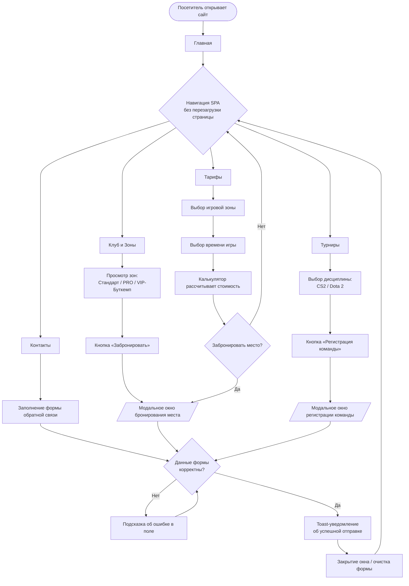

 🎓 Deadman Cyber Club
=====================

Описание
--------
**Deadman** — это современный одностраничный (SPA) статический сайт киберспортивного компьютерного клуба, выполненный в мрачной киберпанк-эстетике с неоново-красными и кислотно-зелеными акцентами. Сайт предназначен для презентации игровых зон клуба (Стандарт, PRO, VIP/Буткемп), расчета стоимости аренды через интерактивный калькулятор тарифов, регистрации команд на киберспортивные турниры по CS2 и Dota 2, а также для бронирования мест и связи с администрацией.

🚀 Функциональность
------------------
- **Адаптивный дизайн:** Полная адаптивность под любые мобильные устройства, планшеты и десктопы на базе Tailwind CSS.
- **Тематическое оформление:** Атмосферный темный киберпанк-режим с кастомными неоновыми свечениями и эффектом глитч-текста.
- **Навигация между страницами:** Плавное переключение между 5 ключевыми разделами (Главная, Клуб и Зоны, Тарифы, Турниры, Контакты) без перезагрузки страницы (SPA-архитектура).
- **Интерактивные элементы и калькулятор:** Интерактивный калькулятор расчета стоимости игры в зависимости от зоны и выбранного времени.
- **Интерактивные модальные окна:** Формы бронирования игровых мест и регистрации на турниры с всплывающими уведомлениями (Toast).
- **Обратная связь:** Форма обратной связи для клиентов и партнеров клуба.

📁 Структура проекта
--------------------
```text
deadman-club/
│
├── index.html       # Главный и единственный файл (HTML + Tailwind CSS + JS)
└── README.md        # Документация проекта
```

🌐 GitHub Pages
---------------
Сайт доступен по адресу: `https://[your-username].github.io/deadman-club`

👥 Разработчики
---------------
- Frontend Developer & UI/UX Designer — Создание макета, интерактивной логики, верстки и адаптива.

📄 Лицензия
-----------
Этот проект распространяется под [MIT License](LICENSE).

🚀 Деплой (развертывание) на GitHub Pages
------------------------------------------
Инструкция по настройке GitHub Pages:
1. Запушить из VSCode весь код в ветку `main`.
2. В настройках репозитория GitHub перейти в раздел **Pages**.
3. Выбрать ветку `main` и папку `/ (root)`.
4. Сохранить настройки.
5. Подождать ~5 мин. для применения настроек и публикации сайта.

📊 Критерии оценки
------------------
| Критерий | Баллы | Описание |
| :--- | :---: | :--- |
| **Полнота реализации** | 25 | Все запланированные разделы и интерактивные формы реализованы и содержательны. |
| **Качество кода** | 20 | Чистый, семантический HTML/Tailwind CSS/JavaScript код. |
| **Git работа** | 15 | Корректное использование веток и коммитов. |
| **Дизайн и UX** | 15 | Высокая адаптивность, продуманный геймерский UI/UX и визуальное оформление. |
| **README.md** | 10 | Полнота и качество документации проекта. |
| **LocalStorage / JS State** | 10 | Реализация интерактивных расчетов и динамических модальных сценариев. |
| **GitHub Pages** | 5 | Успешный деплой и доступность сайта онлайн. |

